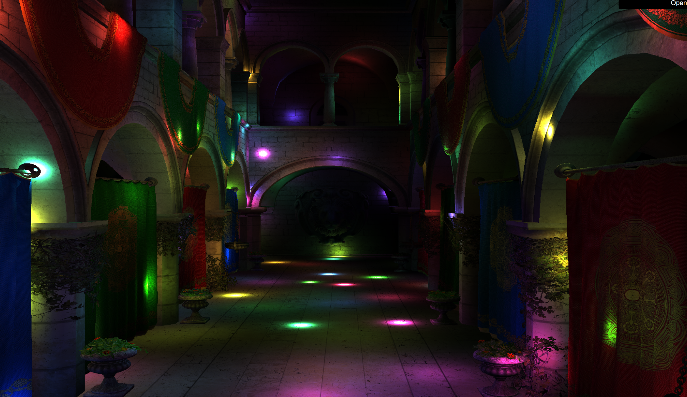
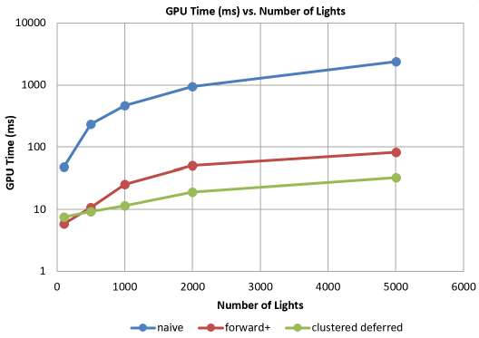
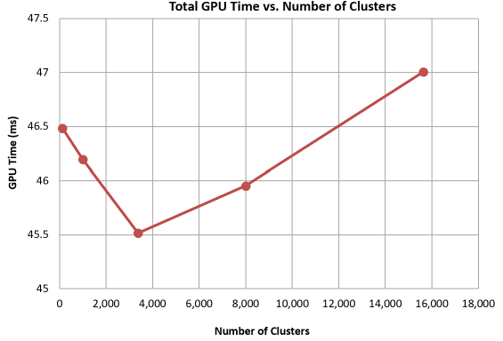
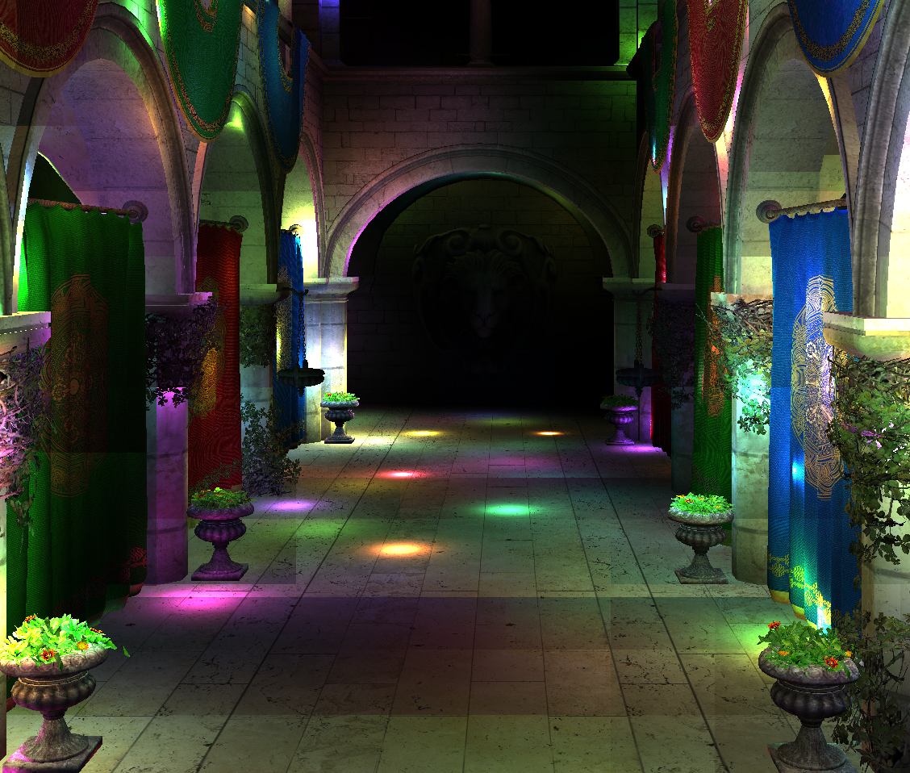

WebGPU Forward+ and Clustered Deferred Shading
======================
University of Pennsylvania, CIS 565: GPU Programming and Architecture, Project 4

Darrel Dsouza
Tested on: Windows 11, i7-12700 @ 2.1GHz 32GB, NVIDIA T1000 4096MB (CETS Lab)

### Live Demo

[darreld081.github.io/Project4-WebGPU-Forward-Plus-and-Clustered-Deferred](https://darreld081.github.io/Project4-WebGPU-Forward-Plus-and-Clustered-Deferred/)

[Demo video recording](img/feature_demo_recording.mp4)

## Overview

In this project, 3 renderers were created for the Sponza scene, each supporting up to 5000 moving point lights.

**Naive** 
Every fragment is rendered in one pass, and in the process, each fragment is shaded by taking into account all lights within the scene.
**Forward+** 
A preliminary compute pass assigns lights to a 3D grid of light clusters. Each fragment then simply loops over the lights in its cluster and calculates light contribution based on same-cluster lights only.
**Clustered deferred** 
This method builds upon Forward+, with the same light clustering, but geometry is first rendered to a G-buffer (position, normal, albedo) and then a fullscreen pass shades each pixel at most once.

The default parameter values for clustering was as follows: 16×16×16 = 4096 total clusters, at most 256 lights per cluster, light radius 2.

## Performance analysis

GPU times are in **milliseconds** from WebGPU timestamps. For each benchmark, the scene was started and run for a warmup period of 150 frames, before collecting GPU runtime data for the subsequent 200 frames. The data for each benchmark was then averaged across the 200 frames to determine a single value for GPU time in ms for each experiment. All tests were run in Google Chrome, at full screen resolution (2074px x 1298px).

### Number of lights (2074×1298, 16³ clusters)
The first experiment involved measuring performance across each rendering method, Naive, Forward+ and Clustered deferred with varying numbers of lights in the scene. The number of lights in the scene were varied from 100, 500, 1000, 2000 and 5000 lights.

| Lights | Naive | Forward+ | Clustered deferred |
|---:|---:|---:|---:|
| 100 | 48.4 | 5.9 | 7.5 |
| 500 | 233.2 | 10.8 | 9.3 |
| 1000 | 468.0 | 25.5 | 11.5 |
| 2000 | 941.1 | 50.8 | 18.9 |
| 5000 | 2374.7 | 82.6 | 32.5 |

- **Naive** GPU usage grows linearly (about 0.47 ms per light) and after a few hundred lights becomes excessively slow resulting in very low FPS (<2 FPS) above 1000 lights.
- **Forward+** Significantly faster than the naive implementation (8x faster at 100 lights and 29x faster at 5000 lights)
- **Clustered deferred** Is significantly faster than the naive implementation (6× faster at 100 lights and 73× faster at 5000 lights). It has a fixed G-buffer cost (about 4.5 to 6 ms) that makes it slightly slower than Forward+ at a low number of lights (~100). However, from 500 lights up it performs better than Forward+, and it is about 2.5× faster than Forward+ at 5000 lights.

### Number of clusters (clustered deferred, 5000 lights, 2880×1350)
The second experiment involved measuring performance in terms of GPU runtime with differing numbers of clusters in the scene. This was done by increasing the cluster splitting within the scene - increasing the numbers of clusters in the X, Y and Z direction. While the default in the previous tests was 16x16x16 clusters, these values were varied from 5x5x5 to 25x25x25 for this experiment to evaluate the performance effect of varying this parameter.

| Grid | Clusters | clustering | gbuffer | gpu total | **total** |
|---|---:|---:|---:|---:|---:|
| 5³ | 125 | 2.05 | 8.06  | 46.49 |
| 10³ | 1,000 | 2.02 | 7.95 | 46.19 |
| 15³ | 3,375 | 2.14 | 8.06 | **45.52** |
| 20³ | 8,000 | 4.53 | 7.38 | 45.95 |
| 25³ | 15,625 | 8.31 | 6.06 | 47.01 |

More clusters make the clustering pass more expensive (we need to test every light against every cluster) but shortens the number of lights we have to evaluate per pixel. This results in a relatively flat timing, however, we do note that there is a slight minimum at a grid size of 15x15x15 indicating that this is the cluster number sweet spot.

### Grid effect when cluster segmentation is coarse

Coarse grids at high light counts show lighting discontinuities along cluster boundaries. Increasing the cluster count or allowing more lights per cluster reduces this effect. This is because less lights will be discarded in neighboring clusters due to hitting capacity, which will result in smoother transitions between clusters.

| 15³ (3,375 clusters) | 30³ (27,000 clusters) |
|---|---|
|  |  |

### Credits

- [Vite](https://vitejs.dev/)
- [loaders.gl](https://loaders.gl/)
- [dat.GUI](https://github.com/dataarts/dat.gui)
- [stats.js](https://github.com/mrdoob/stats.js)
- [wgpu-matrix](https://github.com/greggman/wgpu-matrix)
